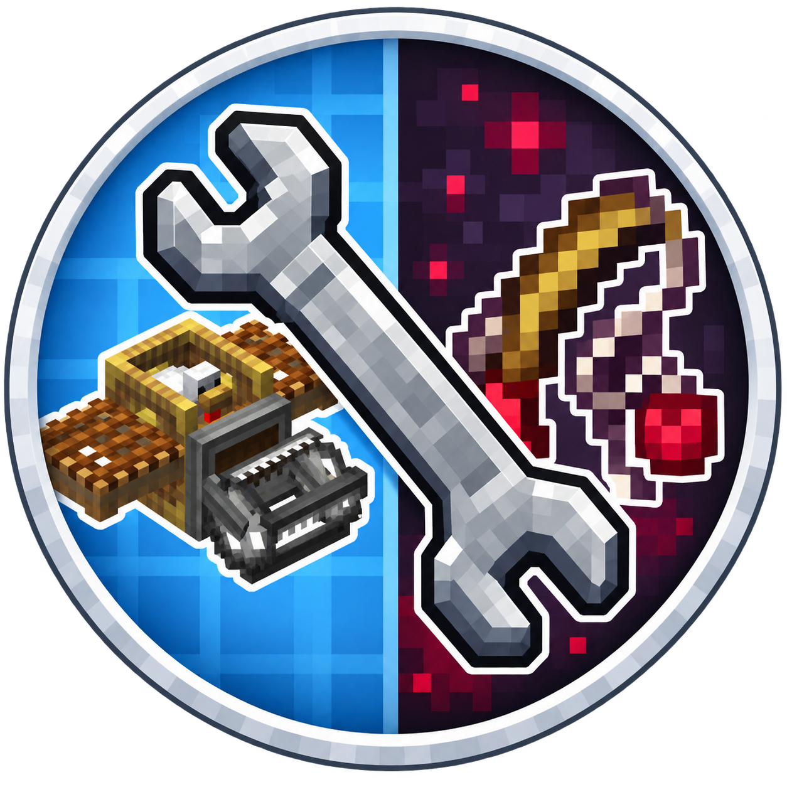

# Fishing Net Starcatcher Fix



<p align="center">
  
  
  
  <a href="LICENSE"></a>
</p>

<p align="center">A small compatibility fix by <a href="https://github.com/OtmiVi">OtmiVi</a>.</p>

## What it does

Fixes a crash when a fishing net from **Create: Integrated Farming** catches a fish with **Starcatcher** installed.

Integrated Farming calls an older version of `FishApi.makeItemStackNonBucket`. Starcatcher 3.3.10 requires an additional fishing bob argument, causing a `NoSuchMethodError` when the net produces a catch. This addon passes the bob that the net already creates.

The fix runs through NeoForge's coremod system at load time. It leaves the original mod JARs, world files, and fishing settings unchanged.

## Compatibility

| Component | Version |
| :--- | :--- |
| Minecraft | 1.21.1 |
| NeoForge | 21.1.233 or newer in the 21.1 series |
| Create: Integrated Farming | 1.4.3 |
| Starcatcher | 3.3.10-NEOFORGE-1.21.1 |

The addon requires the listed Integrated Farming and Starcatcher versions. Install their normal dependencies as well.

## Installation

1. Close Minecraft.
2. Place `fishing-net-starcatcher-fix-1.0.0.jar` in your instance's `mods` folder.
3. Start the game with NeoForge.

For a dedicated server, place the addon in the server's `mods` folder. To remove the fix, remove this addon's JAR.

## Building

Requires **JDK 21** and **Maven 3.9+**.

```sh
mvn clean package
```

The mod is built to:

```text
target/fishing-net-starcatcher-fix-1.0.0.jar
```

A separate `-sources.jar` contains the source code. GitHub Actions also builds both JARs on pushes and pull requests.

## Source

```text
src/main/
├── java/io/github/otmivi/fishingnetfix/
│   └── FishingNetStarcatcherFix.java
└── resources/
    ├── icon.png
    ├── META-INF/
    │   ├── coremods.json
    │   └── neoforge.mods.toml
    └── coremods/
        └── fishing_net_starcatcher_fix.js
```

The Java class registers the addon. The JavaScript transformer contains the compatibility fix.

## Validation

The transformer has been checked with NeoForge coremods 7.0.3. Isolated JVM tests reproduced the original error and passed six cases after applying the fix, including successful catches, empty results, and exception cleanup. These checks use simulated game dependencies; a complete in-game test is separate.

## License

[MIT](LICENSE)
